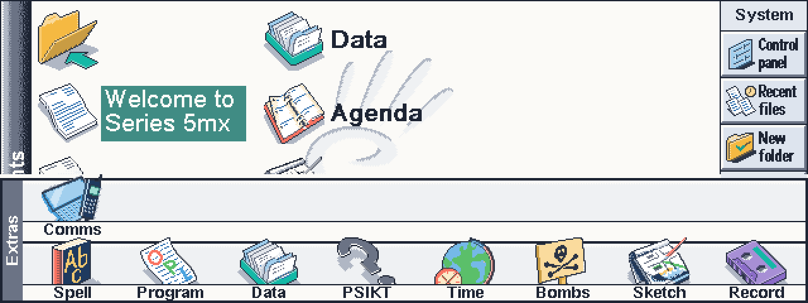
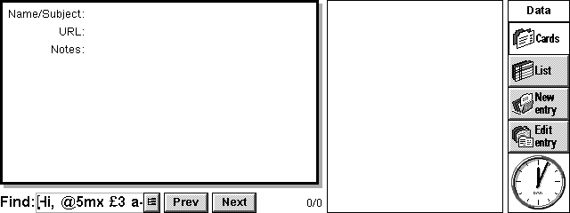
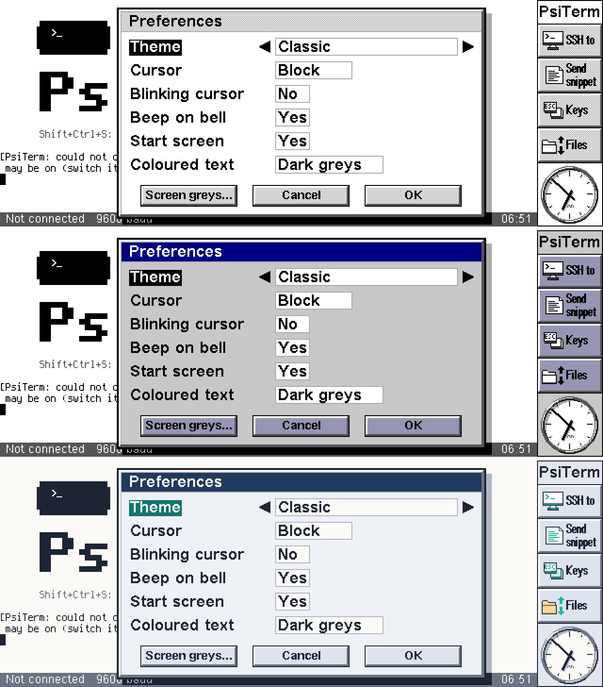
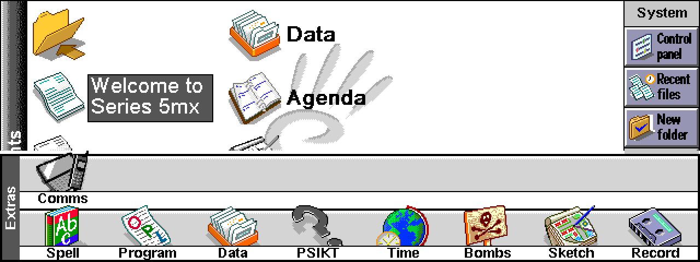

# PsiCast

Shows the **Psion Series 5mx**'s screen, live, in a web browser - on an iPhone, say - through an M5Stack Atom on the Psion's serial port, **in colour if you like**, and, if you allow it, lets the person watching tap and type on the Psion. It can also turn the Psion into a Bluetooth keyboard for your phone.

<p align="center"><br><i>A 5mx's System screen on the phone, in colour: the Modern theme</i></p>

- **In colour.** The viewer can colour the 5mx's greyscale screen as if EIKON had been drawn in colour: title bars, buttons, the toolbar, selections, scroll bars and menus each get their own colour, and the icons are swapped for colour pictures. Choose **Series 7** (the colours and the colour icons of the Psion Series 7, from its own ROM) or **Modern** (a flat palette of today's), or one of seven simpler tints (5mx LCD, Paper, Amber, Green screen, Dark, Warm, Mint). It's all done on the phone, so it costs the Psion nothing. See [*Colour themes*](#colour-themes).
- **Live:** the whole 640 x 240 screen in its 16 greys, as the Psion draws it, up to 20 updates a second while it changes; a change after a still spell shows within about a tenth of a second.
- Watch only, as standard. **Allow control from the viewer** lets the viewer tap the screen and the icons round it, and type.
- **Pause** (Shift+Ctrl+W, in every program while sharing) stops sending before you type a password; the viewer keeps the last picture.
- **Type on phone** (Shift+Ctrl+B): the Psion's keyboard types into the phone, with the Atom as its Bluetooth keyboard.
- It can go on sharing after PsiCast has closed, and stops by itself when the batteries are low.

**Status: in daily use** on a 5mx and an AtomS3R, with an iPhone's Safari (as a Home Screen app) watching. It also runs in a 5mx emulator end to end, with a stand-in for the Atom (see *Testing*).

PsiCast is part of the [PsiTerm suite](https://github.com/danieledge/psiterm) (PsiTerm, PsiMail, PsiWeb) and uses its networking and its Atom modem firmware.

<p align="center"></p>

## What you need

- A Psion Series 5mx (EPOC R5).
- An **M5Stack AtomS3R** with the **Atomic RS232 base**, plugged into the Psion's serial port, on the same Wi-Fi network as the phone. It runs the PsiConnect modem firmware with PsiCast built in (below).
- A phone or computer with a web browser. The first target is Safari on an iPhone.

## Getting started

### 1. The Atom's firmware

Download the AtomS3R firmware from the [latest release](https://github.com/danieledge/psicast/releases/latest):

| File | What it is for |
|---|---|
| [`psicast-atoms3r-factory.bin`](https://github.com/danieledge/psicast/releases/latest/download/psicast-atoms3r-factory.bin) | The **first** flash, over USB: the whole image (bootloader, partition table and firmware), written at `0x0` |
| [`psicast-atoms3r-update.bin`](https://github.com/danieledge/psicast/releases/latest/download/psicast-atoms3r-update.bin) | **Updates** later, from the Atom's own web page (*System > Upload & flash*): the firmware alone |

It is the PsiConnect modem firmware from [`firmware/atom-modem`](https://github.com/danieledge/psiterm/tree/dev/firmware/atom-modem) in the PsiTerm repository - the Hayes modem PsiTerm, PsiMail and PsiWeb use - with PsiCast's module (this repository's `atom/`) built in. So the one Atom is both the Psion's modem and its screen-sharing box, and PsiTerm and the others work with it as before.

**First flash (USB):** connect the AtomS3R to a computer with a USB-C cable. If it isn't seen, hold its button while plugging it in (the download mode). Then either

- in Chrome or Edge, open the [ESP web flasher](https://espressif.github.io/esptool-js/), *Connect*, and program `psicast-atoms3r-factory.bin` at address `0x0`; or
- from a terminal: `pip install esptool`, then
  `esptool.py --chip esp32s3 write_flash 0x0 psicast-atoms3r-factory.bin`.

Unplug it and plug it into the RS232 base.

**Wi-Fi and the web password:** with no network saved, the Atom starts an access point, `PsiConnect-xxxx`. Join it from the phone and the Atom's pages open: choose your network, *Join and save*, and set a **web password** (user `atom`): the viewer asks for it. The Atom shows its address on its screen. The firmware's own [README](https://github.com/danieledge/psiterm/tree/dev/firmware/atom-modem#first-set-up-wifi) has the details, and the AT commands (from PsiTerm's terminal) for doing it from the Psion.

**Updates:** open the Atom's address in a browser, *System > Upload & flash*, and choose `psicast-atoms3r-update.bin`. The Atom tries the new firmware and goes back to the old one by itself if it doesn't start properly.

PsiCast is on in the firmware as standard; `AT$CAST=0` turns it off. More on the Atom's side: [`atom/docs/ATOM.md`](atom/docs/ATOM.md).

### 2. PsiCast on the Psion

Download [`PsiCast.sis`](https://github.com/danieledge/psicast/releases/latest/download/PsiCast.sis) and install it (to D: if you have a CF card). PsiCast is on the Extras bar. It connects to the Atom the way Tools > Connection settings says: the modem route (the serial port) or Psion Internet (PPP through the Atom), the same settings as PsiTerm, PsiMail and PsiWeb.

### 3. The viewer on the phone: as a Home Screen app

Open the Atom's address followed by `/screen` (for example `http://192.168.1.40/screen`) and enter the web password. Then **add it to the Home Screen and use it from there**, as an app (a progressive web app):

- **iPhone (Safari):** the Share button, *Add to Home Screen*. **Android (Chrome):** the menu, *Add to Home screen* (or *Install app*).
- Opened from its icon it has the whole screen, with no browser bars, and it remembers its theme and settings. The viewer's settings (the gear) can open it **in full screen** every time, and pick the colour theme.
- One limit: browsers only keep the phone's screen awake for secure (`https://`) pages, and the Atom's pages are plain `http://`, so the phone may lock while you watch. Set Auto-Lock longer if that matters.

## Using it

1. Tap **Share** on the toolbar (or press Shift+Ctrl+G). PsiCast connects to the Atom the way Tools > Connection settings says - the same settings as PsiTerm, PsiMail and PsiWeb - and says "Sharing the screen".
2. On the phone, open the Atom's address followed by `/screen`, for example `http://192.168.1.40/screen`. The Atom shows its address on its own screen; PsiCast shows it too once the Atom has said. The page asks for the Atom's web password.
3. Go to the program you want to show: tap **Back** (Shift+Ctrl+Y) to return to the one you used last.
4. To stop, tap **Share** again (or Shift+Ctrl+E).

| Key | |
|---|---|
| Shift+Ctrl+G, Shift+Ctrl+E | start, stop sharing |
| Shift+Ctrl+W | pause sharing, and go on again (works in every program while sharing) |
| Shift+Ctrl+R | allow control from the viewer, or not (it asks first) |
| Shift+Ctrl+Y | go to the previous program |
| Shift+Ctrl+B | type on the phone, and stop (the one key not sent to the phone) |
| Ctrl+K | Preferences |
| Ctrl+U | disconnect Psion Internet |
| Ctrl+M, Shift+Ctrl+M, Ctrl+T | zoom, show the toolbar |
| Shift+Ctrl+H, Shift+Ctrl+A | Help, About |

**Preferences** (Ctrl+K): the highest update rate (2, 5, 10 or 20 a second), allow control from the viewer, stop sharing when the battery is low, and what happens when PsiCast closes (stop sharing, or keep sharing until you open PsiCast again and stop it).

<p align="center">


</p>

### Control from the viewer

With control allowed, the viewer's taps and keys reach the Psion as if they were yours: taps on the screen and on the icons round it (Menu, the program icons, Extras), keys, and text typed on the phone. Text is turned into the 5mx's own keys (`@` is Fn+4, `£` Shift+3, and so on); characters the keyboard has no key for, such as accented letters, are left out. The viewer cannot switch the Psion off. While control is off, or sharing is paused, the viewer's input is ignored.

<p align="center"><br>What the viewer sees: text typed on the phone, in Data's Find box</p>

### Typing on the phone

**Share > Type on phone** (Shift+Ctrl+B, or **Type** on the toolbar) makes the Psion the phone's keyboard: the Atom is a Bluetooth keyboard paired with the phone, and every key typed on the Psion goes to it ([`docs/PROTOCOL.md`](docs/PROTOCOL.md), *The phone keyboard*). It needs an Atom with a phone keyboard (WELCOME says so); otherwise the command is dimmed and says "Not available - the Atom has no phone keyboard".

- Pair once: on the iPhone, Settings > Bluetooth > *PsiConnect keyboard*, while PsiCast says "Waiting for the phone". Set Settings > General > Keyboard > Hardware Keyboard to British, so the symbols come out as on the Psion.
- The keys: characters as the Psion's layout makes them; Ctrl+letter as Ctrl+letter; Menu is Cmd (held: Menu+Tab, Tab switches apps); Enter, Esc, Tab, Del, Fn+Del or Shift+Del (forward delete), the arrows, and Fn+arrows (Home, End, Page up, Page down).
- While typing, PsiCast takes every key (the Menu key too) before EIKON does. Shift+Ctrl+B, the big **Stop typing** target on the screen, Type on the toolbar, or going to another program stops it.
- Not sharing: PsiCast connects to the Atom for the keyboard only, and sends no pictures (as paused). Stop sharing while typing keeps that connection; stopping typing then hangs up.

### Connection and power

- **Modem route:** PsiCast dials the Atom's own address (`ATDT192.168.7.1:5961`), and the serial port is PsiCast's while it shares: PsiTerm and the others can't use the modem meanwhile.
- **Psion Internet:** PsiCast connects to the Atom over the PPP link, which other programs can use at the same time.
- If the Atom doesn't answer, PsiCast tries again by itself, less often as time goes on. The line at the bottom of its screen says why.
- PsiCast reads the screen only while someone is watching and the Psion is on, and only glances at it when the screen is still: a quarter of the frame buffer 20 times a second (about 1.5 ms each), nothing encoded or sent.

### Colour themes

The Psion sends only its 16 greys; the colouring is done by the viewer, on the phone, so it costs the Psion and the link nothing. Pick a theme in the viewer's settings (the gear, *Look*); each viewer has its own.

- **5mx LCD** (the standard), **Paper**, **Amber**, **Green screen**, **Dark**, **Warm** and **Mint** map the 16 greys onto a range of colours: from the theme's ink to its paper, or along a few chosen stops.
- **Series 7** and **Modern** colour the Psion's interface itself, as a colour EIKON would have drawn it: dialog title bars, buttons, the toolbar, selections, scroll bars, menus, and the icons. **Series 7** uses the colours and the colour pictures of the Psion Series 7, the 5mx's colour sibling, from its own ROM. **Modern** is a flat palette of today's (navy, slate, teal on a warm white), with its own pictures drawn for it.

<p align="center"><br>The same dialog in Paper (the Psion's own greys), Series 7 and Modern</p>

**How the interface colouring works.** A palette alone can't do it: the 5mx draws a dialog's title bar, its buttons, the toolbar, menus and scroll bars all in the same light grey, and the Series 7 colours only some of them. So the viewer finds the parts by the shapes EIKON draws them with (the SDK's own drawing code):

- **A dialog:** its thick raised border, then a light grey title bar with a grey line under it, then the body.
- **A command button:** a black line all round, white along the top and left, dark grey along the bottom and right, round a light grey face.
- **The toolbar:** the box down the right-hand side, its buttons its full width (a set one, sunken and white).
- **A selection:** a solid black (or, without the focus, dark grey) box with white writing and nothing else round it; not a busy message or an infoprint, which look alike but sit in a border.
- **A scroll bar** (23 pixels wide, black down both sides, its arrows and thumb drawn as buttons) and **a menu** (a dialog's border with no title bar).

Each part found is filled from its edges in with its colour, holes in its writing included (the inside of an e or an o); anything it doesn't recognise keeps its plain greys, which is far better than colouring someone's document. A big change arrives a strip at a time, top first, and a dialog is coloured as far as it has come. The pass runs on the whole screen at most every 150 ms and takes a few milliseconds on a phone.

**Dithered greys.** The 5mx makes its light grey from a fine checkerboard of two greys; on a phone's sharp screen that shows as a pattern. Series 7 and Modern paint such a checkerboard as one flat colour, up to its edges and its writing, while a lone dot or the hole in a letter stays as it is.

**Icons.** The 5mx draws its pictures (program icons, toolbar pictures, the Extras bar) with a mask, pixel for pixel the same every time, so the viewer can find each one exactly: it keeps an index of the 5mx's own pictures (`atom/src/s7icons.json`, `atom/src/modicons.json`), looks for them in every change, and paints the theme's colour version over each one it finds (only an exact match; one partly hidden by a menu is still found by the rows that show). The Series 7's colour pictures were paired with the 5mx's grey ones by `atom/tools/s7icons.py`; the Modern ones are drawn by `atom/tools/modicons.py` from the specs in `atom/tools/modicons/`. The pictures of PsiTerm, PsiMail, PsiWeb and PsiCast are in the Modern pack too.

<p align="center"><br>The System screen in Series 7, with the Series 7's own colour pictures</p>

What stays grey: the contents of documents, photos and web pages (Modern's evenly spaced greys keep their tones, with a cool tint), and anything a program draws its own way. The code is `atom/src/viewer.html` (`findRoles`, `paintRow`) and `atom/src/iconmatch.js`; `atom/hosttest/test_roles.js` and `test_iconmatch.js` check them against real 5mx screens.

## How it works

PsiCast is two programs, like the others in the suite: `PsiCast.app`, the window and the settings, and `psicast.exe`, the engine, which runs only while sharing and talks to the app through a shared memory chunk (`engine/psicast.h`).

- **Reading the screen:** the engine reads the LCD frame buffer directly (`UserSvr::ScreenInfo`; the 32 bytes before it are the LCD palette, whose first entry gives the depth). The depth follows the program in front: the System screen is 4 greys (2 bits a pixel), 16-grey programs 4 bits. At start the engine compares the frame buffer with the window server's own copy of the screen (`CWsScreenDevice::CopyScreenToBitmap`), to be sure of the pixel order and polarity; if the frame buffer can't be read, that copy is the slower fallback.
- **Encoding:** `cast/codec` works out what changed (tiles, scrolling) and deflates it. The protocol to the Atom is in [`docs/PROTOCOL.md`](docs/PROTOCOL.md), the codec in [`docs/CODEC.md`](docs/CODEC.md). At most two updates are unacknowledged; changes made meanwhile are merged into the next, so the viewer always gets the newest picture, never a backlog.
- **Input:** `UserSvr::AddEvent`, the same raw events the digitiser and keyboard make, checked and rate-limited first.
- The log is `psicast.log` in PsiCast's folder (`psicast.old` the run before).

## Building

PsiCast builds inside a [PsiTerm](https://github.com/danieledge/psiterm) checkout (its `dev` branch), as `cast/`: it uses PsiTerm's networking (`ssh/`), its build environment and its emulator tools. The EPOC R5 SDK goes beside the checkout, as PsiTerm's [`docs/BUILDING.md`](https://github.com/danieledge/psiterm/blob/dev/docs/BUILDING.md) says.

```
git clone -b dev https://github.com/danieledge/psiterm.git
cd psiterm
git clone https://github.com/danieledge/psicast.git cast
tools/docker/psibuild setup                # once: the build image and the SDK
tools/docker/psibuild "cast/build.sh"      # cast/dist/PsiCast.sis
```

**The Atom's firmware** with PsiCast in: link the module into the firmware's `ext/` folder, then build with PlatformIO (the firmware's build picks up any module linked there; `AM_EXT=0 pio run` builds it without):

```
ln -s ../../../cast/atom firmware/atom-modem/ext/cast
cd firmware/atom-modem
pio run -e atoms3r                         # .pio/build/atoms3r/firmware.bin
pio run -e atoms3r -t upload               # or straight onto an Atom on USB
```

`cast/build.sh` builds `psicast.exe` with `engine/engine.mk` and `PsiCast.app` with makmake in a project of its own, so its objects don't mix with the other programs' in the SDK's shared folders.

## Testing

Make a card with `node --experimental-strip-types tools/emu/mkcard.ts psicast`. The Atom's own firmware runs on a PC as `cast/atom/hosttest/hostmodem` (`make -C cast/atom/hosttest hostmodem`, the firmware's hostmodem with PsiCast in; run it with `HOSTMODEM_CAST=1`; the viewer page is then at `http://127.0.0.1:5980/screen`), and the emulator's serial bridge can dial it like the real Atom.

`test/fakeatom.py` is a simpler stand-in for the Atom's end of the link: a Hayes modem on a unix socket (or a TCP port) that answers `ATDT192.168.7.1:5961`, decodes every update with the real codec, writes the screen as PNG, and can send the viewer's input from a script. With the emulator's serial bridge (`tools/emu/run.sh`, `EMU_SERIAL`):

```
python3 cast/test/fakeatom.py --unix /tmp/psicast/sock --out build/cast-atom \
    --control --answer-status --sim-clock --input taps.txt &
EMU_SERIAL=/tmp/psicast/sock tools/emu/run.sh cast \
    "50 22 40" "50.05 18 40" "50.2 71"          # Shift+Ctrl+G: start sharing
```

`cast/test/emu/kbdtest.sh` types on the phone in the emulator: `fakeatom.py --kbd` plays an Atom with a phone keyboard (KBD 2, then 3), and the KEYS the Psion sends must be those in `cast/test/emu/kbd.expect` (letters, Shift and Fn symbols, Ctrl+letter and Ctrl+digit, Menu+Tab held, arrows, Fn+arrows, Enter, Esc, Del, Fn+Del, Shift+Del, Space, Menu alone, and Shift+Ctrl+B to leave).

The decoded screens match the emulator's own screenshots pixel for pixel, at 4 and 16 greys. `--answer-status` and `--sim-clock` are for the emulator, which runs many times faster than real time while the Psion is idle.

## Credits

- **The 5mx's face** in the viewer's full screen (`atom/src/silk5mx.jpg`) is the 5mx skin of the Psion Web Emulator, with the screen area cut out: "Psion Web Emulator by Joe Haines — https://joehaines.com/psion".
- **The Atom's home picture** (`atom/tools/system5mx.png`) is the 5mx's own System screen.
- **The Series 7 theme's colours and pictures** come from the Psion Series 7's own ROM (EIKON's colour list, and the colour versions of the 5mx's icons, paired by `atom/tools/s7icons.py`). They are Psion's.

## Support

PsiCast is free. If it's useful to you, see the Support section of [PsiTerm's README](https://github.com/danieledge/psiterm#support).

## Licence

MIT (see `LICENSE`), but for the parts listed under *Credits*, which are their owners'.
